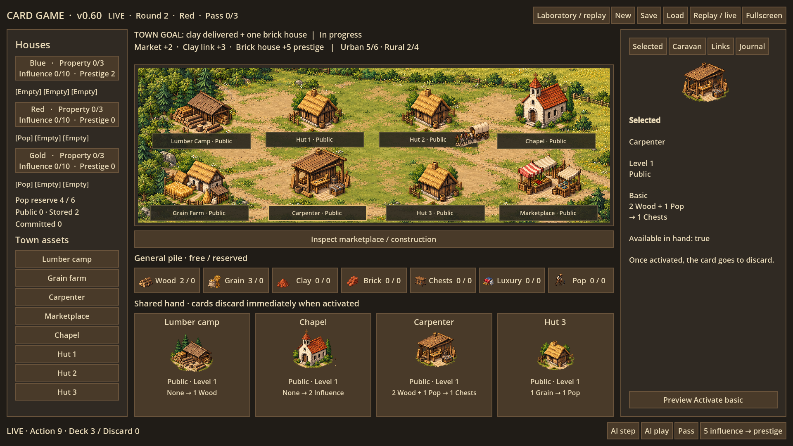

# Card Game — Town and Houses · v0.60

A 2D Godot prototype of a cashless town economy. Houses compete and cooperate through influence, labour and shared resources. The current scenario asks how hard it is to obtain a decent brick house when all bricks must come from a caravan.



## Start testing

1. Install **Godot 4.5 or newer**; the standard edition is sufficient.
2. Download this repository's ZIP and extract it.
3. Import **project.godot**, then press **F5**.
4. Use **Fullscreen** or **F11** on a 1920 × 1080 display. The minimum client area is 1920 × 1080; larger windows expand the board.

This is a Godot source project, not a standalone Windows executable. It needs no external plugins or asset downloads after the project is extracted.

## Controls

- Click a building sprite, town-asset name, card, resource or house to inspect it.
- Click a **Preview** action, inspect its inputs and influence transfers, then **Execute**. You control whichever house is currently acting; this is hotseat testing.
- **AI step** performs one decision for the current house. **AI play** advances automatically; press **Pause AI** to stop. You can mix manual and AI turns.
- **Pass** and **5 influence → prestige** open an action review. Illegal actions cannot execute.
- **Save / Load** preserve the full simulation and exact RNG state. Loading starts a fresh journal from the loaded state. Saving while viewing history saves the latest live state.
- **New** starts a new game using the seed/link configuration in Laboratory.
- **Replay / live** switches between the historical seed-7 recording and your current session.
- **Laboratory / replay** opens the current session history. Previous, Next and the scrubber inspect past states; return to the latest live frame to act. Historical playback never changes the live simulation.
- Laboratory also contains seed selection, optional preset lumber link, **Regression batch · 6**, and **Open logs**. The batch runs seeds 1, 7 and 42 with manual timber and with a preset timber link. It does not replace your active game.

Game actions stop when clay import has delivered and at least one house owns an upgraded brick home. This is a shared scenario end condition, not an individual victory rule. The interface remains available for inspection after completion.

## Current art

Transparent building and goods atlases and a town-ground backdrop follow the approved Colonization–Anno-inspired pixel-art direction. Town sprites, cards, goods, influence/prestige symbols and the interface share that direction. Art is generated original prototype material, not extracted game assets. Art source files and prompt records are in `art/`. Nearest-neighbour texture filtering preserves their edges. Town placements are a fixed presentation of the current plots, not a transportation or adjacency rule.

No music, sound design or animation has been added. Later systems such as money, specialist classes, research and overbuilding remain design ideas.

## Logging and tests

All manual and AI actions go through `GameProbe` and the existing simulation legal-action gate. Every step checks invariants and records the action, AI alternatives when relevant, event and complete resulting state. Action previews query the engine's payment planner and do not mutate the game.

Logs are under Godot's `user://runs/`; **Open logs** opens that location. Saves are under `user://saves/manual.json`. Each new game/load receives its own journal, and older runs remain available.

```sh
godot --headless --editor --import --quit
godot --headless --path . -- --ui-check
python3 tools/run_checks.py --godot /path/to/Godot
```

v0.60 validation: native UI over 83 recorded states, all inspector selections/tabs/action previews, manual execution, AI stepping, exact save/load, and minimum layout sizing. The current six-game regression completes 82 checks and 486 decisions without failures. The native interface was also rendered with Godot/OpenGL at 1920 × 1080 for visual inspection.

Command-line experiments remain available:

```sh
godot --headless --path . -- --experiment=marketplace --seed=42 --rounds=40 --lumber_link=false --output=user://runs/seed42
```

Historical modes are `commons`, `reservations`, `housing` and `cash`. Their documentation and rule files remain in the project. Full batch evidence can be regenerated with the check runner; the repository includes one original marketplace journal plus the compact replay projection used by the interface.

See [release notes](docs/RELEASE_0_60.md), [current scenario rules and results](docs/MARKETPLACE_EXPERIMENT_004.md), and [the suggested next scenario](docs/NEXT_SCENARIO_005.md).

Versions advance by 0.05: **0.50 → 0.55 → 0.60 → 0.65**.
