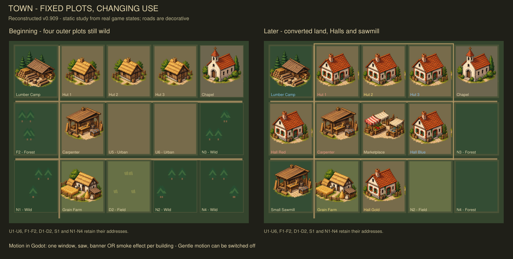

# Card Game — Town and Houses · v0.910

A native 2D Godot prototype of competing noble/merchant houses in one developing town. Houses pursue a good home, an owned industry, a House Hall, then further opportunities. Shared cards, physical goods, labour, influence, prestige, gold and access rights make this a planning economy.

## Documentation and new-thread handoff

Start with [the handoff](docs/THREAD_HANDOFF.md). Canonical references: [current game inventory](docs/CURRENT_GAME.md), [actual player AI](docs/PLAYER_AI.md), [design ideas](docs/Medieval_Town_Design_Synthesis_and_Next_Test.md), [decisions and open work](docs/ISSUES_AND_QUESTIONS.md), and [file inventory](docs/FILES_AND_DOCUMENTS.md). Current release is **v0.910 / schema18**. See the [UI release and validation](docs/UI_RELEASE_0_910.md). Historical numbered reports remain scoped to their original versions.

## Play

Use Godot 4.5.1 standard or newer. Download this repository as a ZIP, extract it, import `project.godot`, and press F5. The interface targets 1920 × 1080; F11 toggles fullscreen. This is an editor-playable source project, not a precompiled Windows executable. Art is included and no external plugins are required.

Shared cards and Deck/Discard are always on top; individual goods are left; the sprite town is central; Build, Upgrade, Contracts and Trade are right; real trade opportunities are below. Game and Info menus hold utilities and explanations; House Info is a separate button.

Choose **Build → structure → highlighted site** to claim a protected construction site, then contribute materials on later actions when its card appears. Select a building for its work, upgrade benefits and token costs. Project tokens show supplied and outstanding materials. Crests distinguish reserved/private goods; held backing and crew are separate. Large token groups can expand.

**Safe Actions defaults Off:** fully specified actions, including Skip, execute immediately. Turn it On under Game for confirmations including access fees and continuing commitments. The preference and Gentle Motion toggle persist separately from the economic save. JSON and seeded test tools remain in Game → Developer diagnostics.

## Contracts and AI

Buy finite cargo for a small need, establish public supply for a temporary flow, or spend influence on priority. A public external route costs one unit's gold price as setup plus 1 prestige; priority adds 2 influence. Both retain transport and pay gold for deliveries. Sponsor cancellation costs 0 prestige for public access or 1 for priority, and consumes an action. Later ownership affects future deliveries only. Rival interference retains escalating prestige costs. Local ownership retains its prestige price and adds 2 influence. The external clay reward follows the first real paid delivery, never signing alone.

The live AI uses one explicit inspectable pipeline with goal, route alternatives, operating/exit budget and next action. It compares bounded private access costs against priority rather than owning a whole flow merely because an input matters. It remains heuristic and does not assume shared export orders guarantee income.

## Recovery and evidence

v0.909 reconstructs the unpublished v0.906–v0.908 work from v0.905 and the development conversation after workspace cleanup. It is not claimed to be byte-identical to the lost files. [Recovery inventory and fresh validation](docs/RECOVERY_0_909.md) describes all restored features, limitations and reproduction commands. New live saves use schema 18. Historical reports through experiment 015 are preserved as historical evidence; new compact test results were regenerated for this reconstruction.

The remaining design issues are longer-term ownership value, business institutions and technologies, and human evaluation of the redesigned playing screen. No new business/technology mechanics were invented as part of recovery.

## Town layout study

The image is a data-driven layout study, not a game screenshot. Motion is available in Godot.

## Repository upload check

4 November 2026: a single-file documentation checkpoint verified uploads on `dev/ui-0.910`. The saved v0.910 release was subsequently restored in progressively larger, verified batches.
