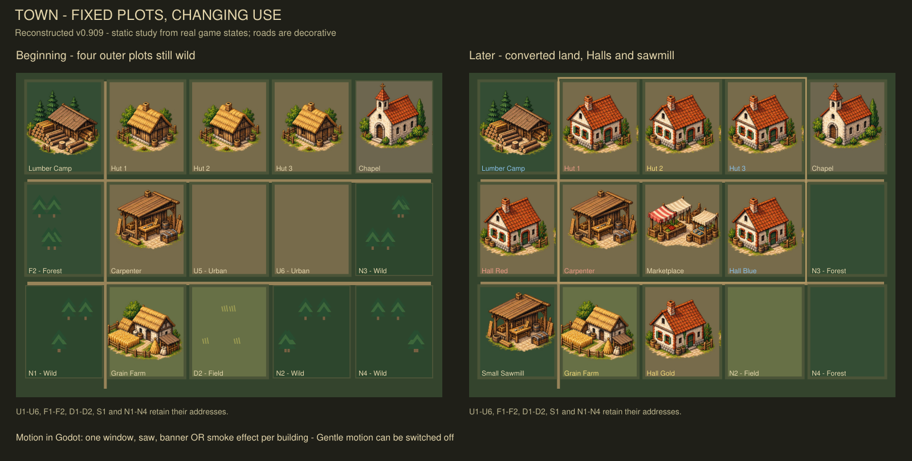

# Reconstruction and fresh validation — v0.909

The unpublished v0.906–v0.908 workspace was removed by automatic maintenance. This release reconstructs its changes from the preserved v0.905 GitHub source and the actual implementation code, design decisions and test procedures in the conversation. It is a tested reconstruction, not a claim of byte-identical restoration. Original v0.905 source/artwork and its historical reports are retained. The results below were generated again for this release.

## Restored feature inventory

| Area | Reconstructed behaviour |
| --- | --- |
| Player AI | One explicit pipeline, one final selection, goal/route/budget/next-action record and stage-by-stage candidate scores; old policies retained as regression references |
| Finite cargo | Buy individual units; delivery on actual expedition return into own storage if room, otherwise public supply |
| Public import route | Setup gold equal to unit price plus 1 prestige; ongoing gold payments and one land capacity; output is public; voluntary cancellation 0 prestige and one action |
| Priority import route | Same setup plus 2 influence; one output has the existing next-action priority; voluntary exit 1 prestige and one action |
| Later ownership | Sponsor can spend one action and 2 influence for future priority; existing public goods stay public |
| Rival interference | Escalating prestige prices and transport transfer retained; ownership also consumes influence; hostile cancellation remains expensive |
| Local contracts | Material setup and prestige ownership prices retained; ownership also consumes 2 influence; unowned creator withdrawal free and own-title withdrawal 1 prestige |
| Town clay reward | Once per town, only after a useful external route actually delivers paid clay; signing and immediately cancelling earns nothing |
| Operating budgets | Count physical supply and incoming cargo; prefund bounded imports; protect operating/exit budgets; shrink or cancel obsolete/unfunded routes; no guaranteed income from shared export orders |
| Ownership judgement | Separate private milestone units from the larger town buffer; compare legal access charges with ownership and exit costs, account for paid own cargo, and assume no invented timing benefit |
| Playing screen | Town / Goods / Cards workspaces; Houses / Buildings sidebar; Inspect / Trade / Plans / Log; technical automation in the laboratory |
| Tangible goods | One unit picture per available physical unit, grouped by public/reserved/private access, exact numeric counts and explicit overflow above twelve pictures |
| Town map | Fifteen fixed addresses: ten initial economic plots, chapel special site and four initially wild outer plots; saved terrain, occupancy and foreground vegetation |
| Development in place | Upgrades, reserved/partial construction, demolition, force replacement, conversion and biome-based claims preserve plot positions and match real capacity |
| Atmosphere | Decorative roads and removable natural foreground; one subtle window, saw, banner or smoke effect per completed building; independent presentation clock and motion-off switch |

## Important boundaries

The town is a first visual scaffold. Exact positions do not create travel, adjacency, road costs, production advantages or new economic land. Commands still choose a building or terrain, and the presentation assigns an eligible fixed address. Halls provisionally reuse brick-house artwork; the small sawmill reuses the carpenter; the kiln has a code-drawn placeholder. Individual trees are not counted by the economy. Foreground vegetation is separate from plants baked into existing building art.

Animations are decorative and do not create goods. Used-this-round markers and legal actions remain authoritative. Window intervals vary through hashes of the building and cosmetic cycle; no game RNG is consumed. Hidden map tabs stop their presentation clock. Reduced motion disables the shared overlay.

Public route owner fields identify the paying/transporting sponsor. Public access is not free town-funded supply. Priority is not an exclusive lock: a rival may pay influence for immediate use, while rival hoarding is prohibited. In the short controlled home cases priority therefore changes access costs rather than completion speed.

The prestige comparison uses the existing five-influence conversion rate as an explicit provisional preference; it does not allow conversion back into influence. Multiple private access charges can also present a liquidity concern. This is still a bounded heuristic, not a general search over all future supplies or business profits. Real business institutions, technologies and the longer-term economy remain future design ideas.

## Fresh validation

- Six original-economy 80-round comparisons reproduce **4,806** v0.905 decisions and every candidate's score. Inspection leaves state and RNG unchanged.
- Six reconstructed-economy 80-round towns execute **4,793** actions, all exactly replayed, with exact save/restore and physical/social/transport/map invariants. All **18 Halls** complete.
- Six controlled cargo/bridge cases execute **302** exactly replayed actions. Each finite case returns two clay and one useful stone without a standing route; each public bridge begins with five gold and one prestige, delivers four clay without misses, then exits and frees transport.
- Six paired competition cases / twelve trials execute **220** exactly replayed actions with exact saves and invariants. Public and priority variants finish the home in the same round in all six pairs. The reconstructed AI recommends public access in all six starting fixtures.
- Focused contract checks: **82**, covering prices, real social-currency sinks, reward timing, access, withdrawals, buyouts, transport travel, budgets, replanning and exact saves.
- Focused saved-map and animation checks: **41**, including occupied/free conversion, wilderness claims, upgrades, force replacement, protected/partial/completed sites, saved coordinates and state/RNG purity.
- Ownership value checks: **8**, covering private versus town need, ownership/exit comparisons, incoming cargo and influence liquidity.
- Human UI checks: **31**, including all central/sidebar tabs, token selection and overflow, exact quantities across archives, map resizing/selection and reduced motion. Largest requested minimum: (1515.0, 839.0), inside 1920 × 1080.
- Existing native archived UI test: 83 states, all selections/previews, manual action, AI step and exact save/load. Expedition UI: 21 commands including public setup, later ownership, cancellation and exact save/load. Their fresh logs are checked for script errors, not just process exit codes.

| Seed | Lumber | Actions | Home + industry round | All Halls round | Halls |
| --- | --- | --- | --- | --- | --- |
| 1 | manual | 820 | 34 | 55 | 3 |
| 1 | preset | 806 | 24 | 51 | 3 |
| 7 | manual | 852 | 29 | 51 | 3 |
| 7 | preset | 827 | 21 | 50 | 3 |
| 42 | manual | 651 | 59 | 64 | 3 |
| 42 | preset | 837 | 32 | 51 | 3 |

## Save compatibility

New games use schema 18. Schema-16, 17 and 18 journals use their corresponding historical engines. The UI does not silently reinterpret an older manual save as a new one. New map addresses and ownership decisions are fully represented in the saved snapshot; there is no unsaved hidden AI memory.

## Reproduce

Import `project.godot` in Godot 4.5.1 standard or newer and press F5. F11 toggles fullscreen. For command-line checks, run `godot --headless --path <project> --script tests/<name>.gd`:

- `planner_equivalence.gd`
- `mapped_town_experiment.gd`
- `flexible_contract_checks.gd`
- `flexible_directed.gd`
- `priority_competition.gd`
- `priority_value_checks.gd`
- `mapped_town_checks.gd`
- `recovered_ui_checks.gd`
- `expedition_ui_check.gd`

For the archived/native UI check, run the project with `-- --ui-check`. Import first so Godot registers global script classes. Compact results are retained under `experiments/*/results.json`; large generated journals/saves are excluded from the downloadable source and can be reproduced. The reconstruction helper scripts are one-time recovery tools; ordinary play and testing do not require running them.

## Persistence

Recovery checkpoints were pushed to `recovery/v0.909` during reconstruction. The tested final revision is published on main after verification. Source, tests, compact evidence and this inventory are preserved in GitHub, rather than relying on temporary download links. The final response identifies the exact published commit.

## Reconstructed visual study

This is a programmatically rendered design study, not a Godot screenshot. It uses the recovered map snapshots and original artwork. The game contains the animations; this picture is static. Automated UI checks are headless; a human visual playtest remains useful.
