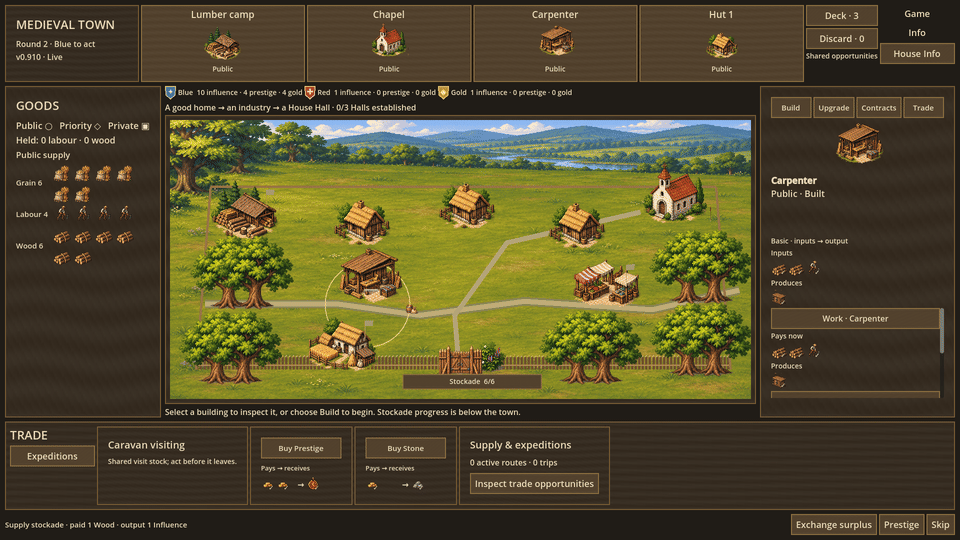

# Medieval Town v0.910 — integrated UI release

Delivered 3 November 2026. Save schema remains 18. This completes the interrupted `dev/ui-0.910` checkpoint (`88a34c0`), preserving v0.909 economics and the twelve recorded decisions. The presentation requirements are retained in [UI_ART_REQUIREMENTS_2026_11_03.md](UI_ART_REQUIREMENTS_2026_11_03.md).

## Delivered behaviour

- Shared action cards are always above the town. Deck and Discard show exact remaining composition, without revealing shuffled order.
- Physical goods are on the left, with distinct public, output-priority and private groups, house crests, private marks, individual unit sprites, exact totals and expandable overflow. Held crew/backing is separately labelled.
- The centre uses an intact landscape, independent buildings, removable plot vegetation, incidental props, atmospheric paths, construction sprites and a progressively built stockade perimeter. The existing fifteen plot identities and economic land budget remain unchanged.
- Build is explicit: catalogue, structure, eligible map site, social claim, then separate later material contributions. Invalid/stale locations are rejected before recording an action. Chosen sites survive save/reload and replay.
- Upgrade and construction views show token requirements and committed progress. Map progress uses the simulation's cost definitions. Partial upgrades retain their original function until completion.
- The right inspector includes Build, Upgrade, Contracts and Trade. Long information/actions scroll. Blocked building/build actions expose specific common gates such as missing influence, an existing unfinished site, a used building or its absent shared card.
- Bottom trade cards expose actual caravan/expedition exchanges and their token flows. Recurring offers have a terms warning; detailed actions show commitments and upkeep. No illustrative mockup barter recipes were invented.
- Game and Info menus replace scattered utilities; House Info is separate. Safe Actions defaults **Off**, persists independently of the save, and can add a confirmation containing inputs, outputs, access payments, commitments and recurring obligations. Changing game/save/replay clears pending confirmation and placement state.
- Human-facing inspectors and recent events avoid raw JSON. AI reasoning displays the selected candidate's recorded reasons and score; complete diagnostics remain under Game. Old recordings receive display defaults on a copy rather than being rewritten as current saves.
- Window, saw, banner and smoke inserts have local sprite anchors, staggered timing and a motion toggle. They do not advance simulation randomness. Kiln, Hall, sawmill, stone and plank sprites now have actual atlas entries.

## Recovery fixes made while completing the release

The remote checkpoint's two new PNG files were corrupt. Their intact generated originals survived in the previous working folder and were copied into the project, then freshly imported and rendered. The footer originally fell outside the 1080p view despite an early minimum-size check; the header, inspector scrolling and actual settled-frame geometry were corrected. Goods icon margins and token check-mark placement were corrected. Historical replay missing-system fields and stale-choice handling were repaired.

## Validation

Godot 4.5.1, with script-error inspection as well as process exit codes:

| Check | Result |
|---|---|
| `tests/ui_redesign_checks.gd` | 32 checks, no failures |
| `tests/ui_delivery_checks.gd` | 73 checks, no failures; includes 80 live AI actions |
| `tests/mapped_town_checks.gd` | 41 checks, no failures |
| `tests/flexible_contract_checks.gd` | 82 checks, no failures |
| `tests/project_checks.gd` | 31 checks, no failures |
| `tests/stockade_checks.gd` | 47 checks, no failures |
| `tests/priority_value_checks.gd` | 8 checks, no failures |
| `tests/expedition_ui_check.gd` | 21 UI commands; exact save/reload |
| Actual OpenGL rendering at 1920×1080 | Opening, location selection, partial construction and visiting-caravan/complete-stockade screens captured and inspected |
| Rendered motion capture | 16 timed frames; simulation snapshot and RNG unchanged |

`tests/recovered_ui_checks.gd` now runs the current delivery suite; the superseded v0.909 tab-geometry fixture is retained in `tests/archive/recovered_ui_0909.gd`. The 314 numbered assertions above are different focused paths, not a balance or strategy metric. The 21 expedition commands and 80 AI actions are separate evidence, not additional numbered assertions.

## Screens and reproduction

The opening screen is the normal seeded start. The three further screenshots use funded fixtures and genuine legal game actions to expose the corresponding states; they do not claim those states were reached organically by the player or AI. `tests/capture_ui.gd` reproduces them with an actual graphics display. Headless checks verify mechanics/geometry, not visual rendering.

## Limits and next review

This is an editor-playable Godot source release, not a compiled Windows executable. The compact local activities are simple inserts, not full animated workers or masks for every building. Contextual explanations cover current gates; complex contract alternatives still require inspection rather than a comprehensive planning tutorial. Human play feedback remains the next test of discoverability, art direction and density. General quantity bindings, research, specialists, institutions, sea transport and a final victory rule remain deferred mechanics, not UI-release omissions.

Each version must have a complete local source checkout plus a persistent downloadable archive; substantial work is checkpointed in git. Future work advances from 0.910 and retains old version archives.
